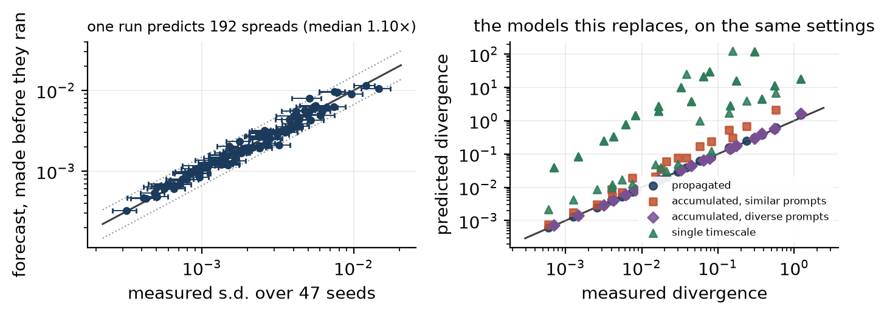

# caliper

[](https://github.com/ITheClixs/rl-caliper/actions/workflows/ci.yml)

How much would an RL post-training score move if you reran it with a different seed, and can one
run tell you before you pay for the others?

A reported score is the output of a stochastic procedure. The usual way to learn its spread is to
train the recipe several times. This repository implements a cheaper estimate and measures where it
works and where it does not. Noise injected at one update is reweighted by the updates that follow
rather than simply accumulated, so the covariance of a run about its mean obeys a recursion.
Carrying the gradient of the reported metric backwards along a single stored trajectory turns that
recursion into an error bar: a sum of one scalar per update, with no covariance matrix formed.



*Left: on enumerable policies, the across-seed standard deviation forecast from one frozen run
against the value measured over 47 seeds trained afterwards (1.0x is perfect; dotted lines are
1.5x). Right: the simpler models this replaces. This is the tier where the method works; the
table below includes the tiers where it does not.*

**Paper:** [full version (PDF)](paper/pdf/caliper.pdf) ·
[eight-page version (PDF)](paper/pdf/caliper-icml.pdf) · LaTeX sources in `paper/`

## Results at a glance

"Error" is the ratio between forecast and measured standard deviation, taken in whichever direction
is above one, so 1.0x is perfect and 2x means off by a factor of two either way. A few other terms:
*enumerable policies* are small tabular policies where every probability can be computed exactly;
a *unanimous reward group* is a set of responses to one prompt that all pass or all fail, which
gives a group-baselined estimator nothing to learn from; *spent seeds* means estimating the spread
from the runs already trained; the *textbook threshold* stops a comparison once the lead clears
the normal quantile of the mistake rate you will tolerate.

| setting | what was compared | result |
|---|---|---|
| enumerable policies, exact inputs, at most 25 updates | forecast frozen before 47 further seeds were trained, 192 settings | median error **1.10x**, worst 1.56x, inside the measured 95% interval in 162 of 192 |
| Qwen2.5-0.5B, four pre-specified corpora, prospective | frozen forecast against 12 held-out seeds | errors 1.66, 2.13, 2.80, 1.24 |
| Qwen2.5-0.5B, corpus whose reward groups go unanimous | cheap forecast against 8 seeds | **25x short** |
| Qwen2.5-7B (4-bit, LoRA) under Adam | lifted forecast against 10 seeds | **3.1x to 17x short** |
| sizing a comparison (enumerable tier, clear pairs only) | runs per comparison, both arms, to reach a 0.1% mistake rate, thresholds chosen on other tasks | **3.14** runs; a fixed budget measured below its cap needs 5.6x to 8.2x as many over 3 seed splits, and estimating the spread from spent seeds 2.12x as many |

Three things the sizing benchmark shows that the headline does not. A closed form that needs no
stored run comes within 1.11x of the forecast once its stopping threshold has been learned on other
tasks (1.18x with its noise traces estimated from one run rather than computed exactly), so on
this tier the backward pass adds little to *ranking* configurations. What the stored
run's scale buys is that one learned factor: at the textbook threshold the uncalibrated closed form
never stops (its scale is off by 84x), the closed form with one scale learned elsewhere decides in
4.64 runs, and the forecast in 4.37 runs, about twice the tuned cost either way. And near-ties are
settled by no policy within the 48 seeds per configuration we have.

Why it fails on pretrained models, as far as the records show: on the counting task those runs
use, most runs learn to answer one constant whatever they are asked. The run the forecast was made
from answers "1" to every prompt and so passes exactly the 17 of 48 prompts whose count is one; at
0.5B, 5 of 8 runs answer a constant, and which constant explains 94% of the across-seed variance
(81-99% over three launches). A constant answer gives every response to a prompt the same reward,
so the group-baselined update is zero and the run cannot leave it. The spread is which constant a
run is absorbed into, a discrete outcome that a linearisation about one absorbed run cannot see,
and it also means much of the measured "learning" on that task is guessing.

That explanation does not reach the support sweep. Its four corpora were rerun with every answer
recorded. Where the forecast held (band 0.85) the runs collapse, but onto the same answer;
where it is 2.80x too large (band 0.60) they barely collapse at all. Two predictions were committed
before the runs that tested them, and both were refuted
([`docs/predictions.md`](docs/predictions.md)). The first, that band 0.60 would split on more
prompts than band 0.85, failed (3 of 64 against 5). The second, that the forecast is too large
where runs share no answers, held at band 0.35 (1 shared prompt) and failed at band 0.15 (2, where
it needed 14). The sweep's errors remain unexplained.

`docs/claims.md` indexes every claim in the paper against the experiment that supports it and how
strongly, including the claims that were withdrawn and why.

## What is not established

* Anything at frontier scale. Every experiment runs on one laptop; the largest model is a 4-bit 7B
  with LoRA, and every pretrained forecast spans at most 12 updates.
* That the forecast is accurate on pretrained models in general. It is inside 1.5x in one of four
  pre-specified regimes, and misses by 25x and by 3-17x in the two other pretrained settings.
* A coverage guarantee for the stopping rule. The textbook threshold realised its target on our grid;
  that is an observation on one grid.
* That the one-run curvature diagnostic bounds the worst case. It ranks failures above chance (AUROC
  0.78) but on the 192-setting grid it accepts the single worst forecast; an earlier claim that it
  capped the tail did not survive doubling the grid and is withdrawn.
* A route from policy divergence to outcome spread via `sqrt(KL)` (fitted exponent `+0.10` against a
  predicted `+0.5`), and a short memory horizon. Both were looked for and not found.

## What is here

```
src/caliper/
  forecast.py   the backward pass, as a protocol any trainer can implement
  objectives/   the estimator family as a (G+1) x 2 weight table
  exact/        enumerable policies: exact scores, Fisher, moments, a trainer,
                the covariance recursion, the adjoint, and Adam's lifted state
  estimators/   the K x 2 split estimator and its sampling harness
  population/   transformers trained as a batched population, and the RLVR trainer
  control/      step size as a feedback loop on realised drift
  real/         the same measurement on a pretrained model through MLX
  analysis/     efficiency curves, interval estimation, sizing, and grid selection
  runtime/      run manifests
experiments/    one directory per experiment, config-driven
runs/           the stored record of every run the paper quotes
analysis/       figure and table generation for the paper
paper/          LaTeX sources and built PDFs
docs/           theory notes, result notes, and the claim index
```

## Using the forecast

`caliper.forecast` is framework-agnostic. Supply one object per update that can answer two
questions about the trajectory you stored, and it accumulates the error bar:

```python
from caliper.forecast import run_backward

class MyUpdate:                  # step_size, n_prompts as attributes
    def projected_variance(self, b):   # Var over prompts of b . per-prompt gradient
        ...
    def jacobian_vector(self, b):      # J b, one Hessian-vector product
        ...

result = run_backward(metric_gradient, updates)                    # full form
cheap = run_backward(metric_gradient, updates, transport=False)    # no Jacobian-vector products
result.std                                # forecast s.d. of the reported score across seeds
result.normal_approx_interval(score, 0.95)  # a normal interval around the score you report
result.kernel                             # each update's share of the variance
result.memory()                           # how many final updates hold 95% of it
```

`caliper.exact.adjoint` runs its forecast through this protocol (`ExactUpdate`). The pretrained-model
version in `caliper.real.adjoint` implements the same recursion inline, because it also carries
Adam's moments backwards and cross-fits the injected term, which the protocol does not express yet.

The full backward pass costs three passes per stored update. The cheap form (`transport=False`)
holds `b` at `grad M` instead of carrying it back: one extra pass per update and no
Hessian-vector products. On the exact tier it changes the forecast by a median of 2% at runs of up
to 25 updates, so it is the recommended starting point. The normal interval assumes the seed
distribution is normal, which the pretrained runs show it need not be.

## Running it

```
uv venv --python 3.12
uv pip install -e ".[dev]"
uv run pytest                                      # includes the exactness tests
uv run python experiments/p2_metric_forecast/run.py  # the forecast, tested prospectively
uv run python experiments/s13_sizing/run.py          # sizing, thresholds read in sample
uv run python experiments/s13_sizing/heldout.py      # sizing, thresholds set before grading
uv run python experiments/s16_saturation/analyse.py  # where the pretrained seed spread is
uv run python analysis/tables.py                   # regenerate every table and paper macro
uv run python analysis/figures.py                  # regenerate every figure
```

The pretrained-model experiments additionally need `uv pip install -e ".[mlx]"` and Apple Silicon.

Every run writes a manifest with its configuration, the commit it ran at, whether the tree was
dirty, and the platform. Numbers in tables and in the paper's macros are generated from those
records, and `tests/test_docs_numbers.py` fails if a number quoted in this README or in `docs/`
disagrees with them. Some numbers in the paper's prose are still typed by hand.

## How this was built

This is a single-author project. I chose the research question and its framing, decided which
experiments to run, judged the results, and decided which claims to keep, correct or withdraw; I
also derived and checked parts of the theory and wrote or debugged parts of the code. AI coding
agents (Claude Code) wrote most of the code, the LaTeX and the documentation, and ran the sweeps
under that direction, which is why the commit history is dense. A revision pass in November 2026,
prompted by an outside review of the repository, was also done with Claude; its commits carry a
`Co-Authored-By` trailer and say what each change was and why.
